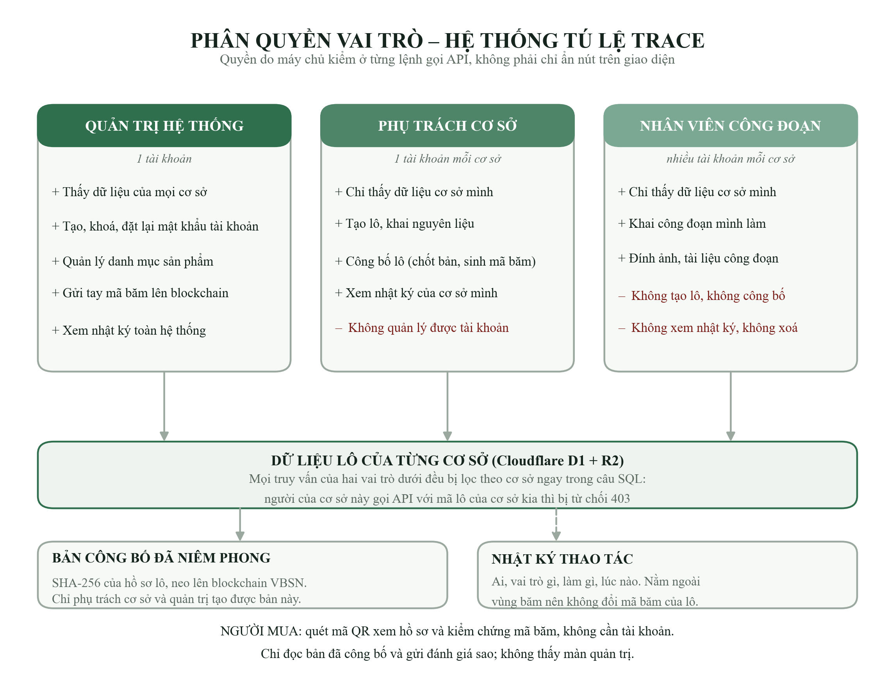

# Phân quyền vai trò của hệ thống Tú Lệ Trace

Viết ngày **23/10/2026**, mô tả đúng hệ thống đang chạy. Phần này trả lời hai
nhận xét của chuyên gia: thiếu sơ đồ phân quyền, và mâu thuẫn giữa câu "mỗi
người tự khai báo" ở mục Điểm mới với câu "tài khoản riêng cho từng cơ sở đang
hoàn thiện" ở mục Hạn chế.

## 1. Sơ đồ phân quyền

## 2. Ba vai trò và việc của từng vai trò

| Việc | Quản trị hệ thống | Phụ trách cơ sở | Nhân viên công đoạn |
|---|---|---|---|
| Xem dữ liệu của mọi cơ sở | Có | Không, chỉ cơ sở mình | Không, chỉ cơ sở mình |
| Tạo, khoá, đặt lại mật khẩu tài khoản | Có | Không | Không |
| Thêm sản phẩm vào danh mục | Có | Không | Không |
| Tạo lô, khai nguyên liệu | Có | Có | Không |
| Khai công đoạn, đính ảnh và tài liệu | Có | Có | Có |
| Công bố lô: chốt bản, sinh mã băm, neo chuỗi | Có | Có | Không |
| Xoá nguyên liệu hoặc công đoạn khỏi hồ sơ | Có | Có | Không |
| Gửi tay mã băm còn trong hàng chờ lên blockchain | Có | Không | Không |
| Khai chỉ số do cơ sở cung cấp vào trang Chỉ số | Có | Không | Không |
| Xem trang Chỉ số | Toàn hệ thống | Lượt xem của cơ sở mình | Không |
| Xem nhật ký thao tác | Toàn hệ thống | Của cơ sở mình | Không |

Người mua không nằm trong bảng này: họ không có tài khoản. Quét mã QR là xem
được hồ sơ đã công bố và kiểm chứng mã băm, và gửi được đánh giá sao. Đây là
chủ ý — bắt người mua đăng ký thì không ai quét.

## 3. Ba điều quan trọng về cách làm

**Quyền kiểm ở máy chủ, không phải ở giao diện.** Giao diện có ẩn nút theo vai
trò, nhưng đó chỉ là phép lịch sự với người dùng. Chốt chặn nằm ở máy chủ: mỗi
lệnh gọi API đều kiểm vai trò, rồi kiểm tiếp dữ liệu được gọi có thuộc cơ sở
của người đó không. Người của cơ sở này gọi thẳng API bằng mã lô của cơ sở kia
vẫn bị từ chối, dù giao diện của họ không hề có nút đó.

**Việc lọc theo cơ sở nằm trong câu truy vấn.** Danh sách lô, danh mục sản
phẩm và các con số tổng quan đều được lọc ngay trong câu SQL, không phải trả về
hết rồi mới ẩn bớt. Nhờ vậy mở công cụ xem lưu lượng của trình duyệt cũng không
thấy dữ liệu của cơ sở khác.

**Tên người khai báo lấy từ phiên đăng nhập.** Khi lưu một công đoạn, hệ thống
không nhận tên người nhập do máy khách gửi lên mà ghi tên tài khoản đang đăng
nhập. Nếu nhận từ máy khách thì dòng "người nhập" chỉ là một ô chữ ai điền gì
cũng được, không còn là bằng chứng. Tên người công bố lô cũng lấy theo cách
đó.

## 4. Mật khẩu và phiên đăng nhập

- Mật khẩu **không được lưu**. Hệ thống lưu kết quả băm PBKDF2-SHA256 với
  100.000 vòng lặp và một chuỗi muối ngẫu nhiên riêng cho từng tài khoản (đây
  là trần của nền tảng Cloudflare Workers). Từ
  bảng tài khoản không có đường nào đọc ngược ra mật khẩu.
- Phiên đăng nhập sống 12 giờ, đủ một ngày làm việc. Máy chủ cũng chỉ lưu mã
  băm của token phiên, không lưu token.
- Khoá tài khoản hoặc đổi mật khẩu sẽ **đóng ngay mọi phiên đang mở** của người
  đó, không chờ hết hạn.
- Sai mật khẩu và sai tên đăng nhập trả về cùng một câu trả lời, mất cùng một
  khoảng thời gian, để người dò không biết tên đăng nhập nào có thật.
- Sai mật khẩu **5 lần liên tiếp** thì tài khoản bị khoá tạm 15 phút rồi tự mở
  lại; quản trị đặt lại mật khẩu là mở khoá ngay. Việc này chặn kiểu dò mật
  khẩu bằng máy, thứ mà một màn đăng nhập mở ra internet luôn phải tính đến.

## 5. Nhật ký thao tác

Mỗi lần đăng nhập, tạo lô, khai công đoạn, tải ảnh, công bố hay sửa tài khoản
đều ghi một dòng: ai, vai trò gì, làm gì, trên lô nào, lúc nào.

Nhật ký nằm **ngoài vùng dữ liệu được băm**, giống như đánh giá của người mua.
Đây là chỗ cần nói rõ trong báo cáo: hồ sơ lô đã công bố được băm SHA-256 rồi
neo lên blockchain, nên thêm bất kỳ trường nào vào phần dữ liệu đó sẽ làm mã
băm khác đi và cả 8 lô đang ĐÃ XÁC MINH lập tức chuyển sang SAI LỆCH. Vì vậy
nhật ký được tách riêng: ghi thêm bao nhiêu cũng không động đến mã băm của lô.

## 6. Sửa câu chữ trong báo cáo cho khớp hệ thống

| Chỗ đang viết | Sửa thành |
|---|---|
| Mục Điểm mới: "mỗi người tự khai báo" | "Mỗi nhân viên công đoạn có một tài khoản riêng; công đoạn do ai khai thì hệ thống ghi tên người đó, lấy từ phiên đăng nhập chứ không nhận từ máy khách." |
| Mục Hạn chế: "tài khoản riêng cho từng cơ sở đang hoàn thiện" | Bỏ câu này. Phân quyền theo cơ sở đã chạy từ 23/10/2026. Nếu cần nêu hạn chế thì nêu đúng cái còn thiếu: chưa có xác thực hai lớp và chưa có quy trình tự lấy lại mật khẩu, hiện do quản trị đặt lại. |
| Bảng kế hoạch hoàn thiện: "Bổ sung các tính năng quản lý nhân sự và phân quyền cho nhân sự — 2 tuần" | Chuyển sang mục kết quả đã làm được. |

## 7. Cách kiểm chứng

| Việc | Cách làm |
|---|---|
| Xem ba vai trò và quyền của từng vai trò | `worker/src/auth.ts`, hằng số `permissions` |
| Chạy thử toàn bộ bảng quyền | `npm run test:phan-quyen` trong thư mục `worker/` (cần một worker chạy local) |
| Xem nhật ký của hệ thống đang chạy | Đăng nhập màn quản trị, mục **Nhật ký** |
| Xem các chỉ số đưa vào báo cáo và nguồn của từng chỉ số | Đăng nhập màn quản trị, mục **Chỉ số** |
| Xem tài khoản và cơ sở | Đăng nhập bằng tài khoản quản trị, mục **Tài khoản** |

Kịch bản `test:phan-quyen` dựng ba tài khoản thử rồi kiểm 40 điều, trong đó
quan trọng nhất là các điều **không** được phép: nhân viên không tạo được lô,
không công bố được lô, không xem được nhật ký; người của cơ sở này không đọc,
không sửa, không công bố được lô của cơ sở kia; tài khoản bị khoá thì phiên
đang mở mất hiệu lực ngay; sai mật khẩu 5 lần thì bị khoá tạm; nhật ký của cơ
sở này không lọt sang mắt người cơ sở kia; chỉ số không ghi nguồn thì không
lưu được, và phụ trách cơ sở không khai được chỉ số. Chạy ngày 25/10/2026:
**40/40 đúng**.
